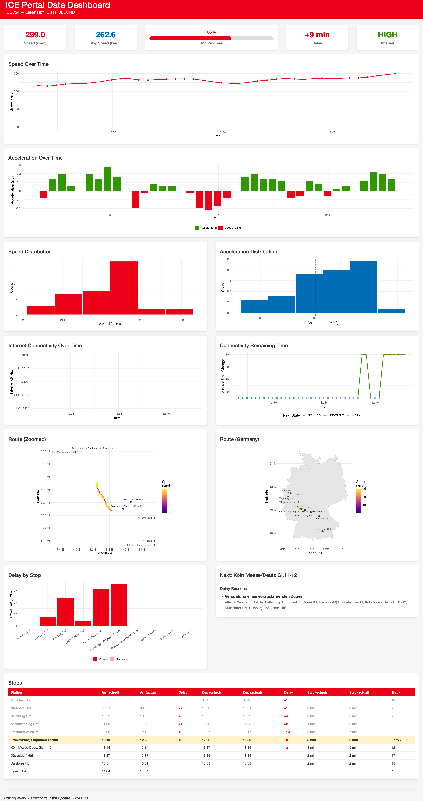

# icePortal 🚄📈

A Shiny dashboard that queries the Deutsche Bahn ICE Portal API to collect and visualize train status data while you ride.

The normal ICE portal will display a train's current speed, but I was curious how this changes over time so I look at the internal APIs that are called by the portal. As it turns out, these APIs expose interesting bits of information, that's not always visible in the UI. Using the API responses I iteratively prompted Claude Opus 4.6 to build this dashboard, making manual adjustments as needed.

This dashboard will **only** work when connected to the on-board WiFi of a Deutsche Bahn ICE train (`WIFIonICE`) as it pulls data straight from the APIs of the train.

## Screenshot



## Installation

```r
# install.packages("pak")
pak::pak("jansim/icePortal")
```

## Usage

Connect to the on-board WiFi of a Deutsche Bahn ICE train, then run:

```r
icePortal::launch_dashboard()
```

## macOS Menubar App

If you'd rather glance at the current speed, next stop and delay than plot the whole trip, there's also a small native macOS menubar app in [`macos/IcePortalBar`](./macos/IcePortalBar):

```sh
cd macos/IcePortalBar
swift run
```

## License

MIT
